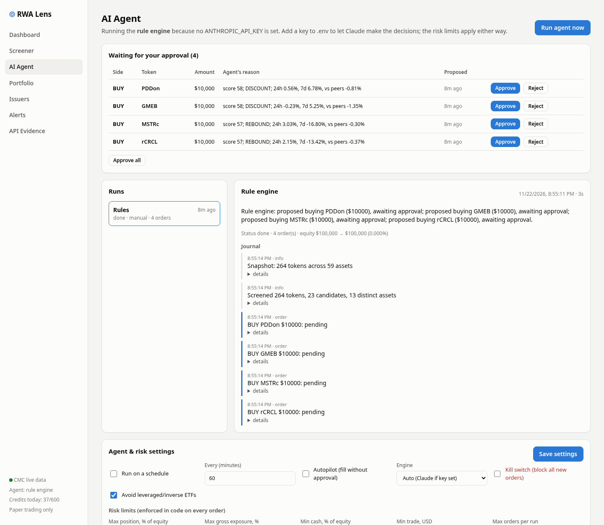
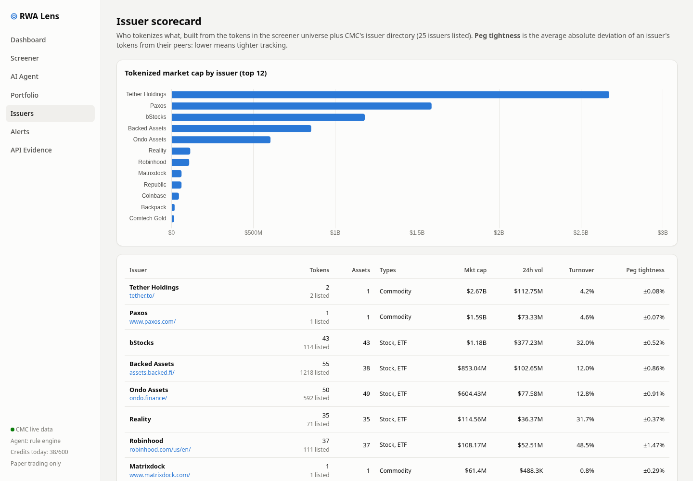

<div align="center">

# ◎ RWA Lens

**Screener, peg monitor and paper-trading agent for tokenized real-world assets, built on the CoinMarketCap API.**

Real World Assets track · CMC API Hackathon Round 2 · #BuildwithCMC

   


</div>

## Why

Tokenized stocks, ETFs and gold are now issued by many companies at once. NVIDIA alone has **seven** live tokens (xStocks, Ondo, bStocks, Robinhood, Coinbase, Reality, wrapped xStock), and gold has PAXG, XAUt, Matrixdock and more. They don't trade at the same price, they aren't equally liquid, and some aren't even quoted in the same unit.

RWA Lens uses CoinMarketCap's new `/v5/real-world-assets` endpoints, together with the classic crypto endpoints, to answer three questions:

1. **Which token should I hold?** Every token is priced against its siblings tracking the same asset. That surfaces discounts, premiums and de-pegs, and detects tokens quoted in a different unit instead of calling them 90% de-pegs.
2. **What's moving, and can I actually trade it?** Token-level momentum, liquidity and turnover, and a 0-100 score.
3. **Can it trade on its own?** A rule-based agent that decides from CoinMarketCap data alone (no external AI service) reads the market, researches candidates and trades a **paper** portfolio. Risk limits are enforced in code, every decision is explained in a journal, and there's an approval queue.

> **Paper trading only, not financial advice.** No real orders are ever sent anywhere; fills are simulated at live CMC prices with fees and size-based slippage. This is an experimental hackathon project, not audited, and nothing it shows (scores, signals, agent decisions) is financial, investment, legal or tax advice. Don't rely on it for real financial decisions.

## Contents

- [Screenshots](#screenshots)
- [Features](#features)
- [Run it locally](#run-it-locally)
- [Demo walkthrough (5 minutes)](#demo-walkthrough-5-minutes)
- [CoinMarketCap endpoints used](#coinmarketcap-endpoints-used)
- [The trading agent](#the-trading-agent)
- [Connect AI agents (MCP)](#connect-ai-agents-mcp)
- [Configuration](#configuration)
- [Project structure](#project-structure)
- [Deploying (Cloudflare Pages or Node)](#deploying)
- [Docs](#docs)

## Screenshots

| Screener | Asset detail |
|---|---|
|  |  |
| **Trading agent: journal, approvals, risk settings** | **Issuer scorecard** |
|  |  |
| **API evidence: every live call, key redacted** | **Dark mode** |
|  |  |

## Features

| | |
|---|---|
| **Dashboard** | RWA tokenized market cap, RWA share of total crypto market cap, off-peg count, equity curve, market cap by asset type, biggest moves vs peers, top movers, latest agent run, alerts |
| **Screener** | ~265 tokens across the top ~60 tokenized assets. Search; filter by asset type, signal, volume and liquidity; sort any column; trade from any row |
| **Asset detail** | 90-day or 7-day hourly history of price and volume; every token tracking the asset with *vs peers*; market pairs where the plan allows |
| **Trading agent** | Run now or on a schedule; balanced, momentum or value style; approve or reject proposals; per-run journal explaining every decision (market regime, filters, research, sizing, risk rejections); risk settings and kill switch |
| **Portfolio** | Positions, realized and unrealized P&L, equity curve, order history with slippage and fees, manual trading, reset |
| **Issuers** | Market cap, volume, turnover and **peg tightness** per issuer |
| **Alerts** | De-pegs (liquid token ≥ 1.5% from peers), stop-loss and take-profit exits, agent runs, trades. Optional Telegram |
| **API evidence** | Every live CMC call with the key redacted, credits per call, cache hits, monthly account usage |
| **MCP server** | The same research tools, plus paper orders, for Claude Desktop, Claude Code or any MCP client |

**Signals:** `DISCOUNT` · `PREMIUM` · `MOMENTUM_UP` · `MOMENTUM_DOWN` · `REBOUND` · `ILLIQUID` · `UNIT_MISMATCH` · `LEVERAGED`. The rules are in [docs/ARCHITECTURE.md](docs/ARCHITECTURE.md#signals-and-score).

## Run it locally

### 1. Prerequisites

- **Node.js 22+** (`node -v`). Get it from [nodejs.org](https://nodejs.org) or `nvm install 22`; the repo includes `.nvmrc`.
- **Git.**
- **A CoinMarketCap API key** (optional). Get one free at [coinmarketcap.com/api](https://coinmarketcap.com/api). Without a key the app runs in mock mode.

### 2. Install

```bash
git clone <this repo> rwa-lens
cd rwa-lens
npm install          # also installs the secret-guard git hook
```

### 3. Add your key

```bash
cp .env.example .env
```

Open `.env` and set `CMC_API_KEY=your-key`. That's the only required setting. `.env` is gitignored, and the secret guard stops you from committing it by accident.

### 4. Build and start

```bash
npm run build        # builds the web UI into web/dist
npm start
```

You should see:

```
RWA Lens on http://localhost:8787
  CMC data: LIVE
  Agent: rule-based strategy on CMC data (no external AI service)
  Paper trading only: no real orders are ever sent.
```

Open **http://localhost:8787**. The sidebar shows the data mode (green = live, amber = mock) and today's credit usage.

### 5. (Optional) Development mode

```bash
npm run dev          # API with hot reload on :8787 + UI dev server on http://localhost:5173
```

### No key? It still runs

With no `CMC_API_KEY`, the app runs in **mock mode** and shows a banner saying so:
- If you've recorded a snapshot (`npm run record`, which needs a key once), it replays those real CMC responses.
- Otherwise it generates a clearly labelled synthetic market in CMC's documented response shapes.

Everything works in mock mode, including the agent, trading and the MCP server.

## Demo walkthrough (5 minutes)

A guided tour once the app is running. Each step names the CMC endpoints behind it.

1. **Dashboard** (`#/`). Market cards: tokenized RWA market cap and its share of the whole crypto market (`/v5/real-world-assets/assets/list` + `/v1/global-metrics/quotes/latest`), and how many liquid tokens are ≥ 1% away from their peers. Below: equity curve, market cap by asset type, biggest moves vs peers, top movers.
2. **Screener** (`#/screener`). Type `NVDA` in search: you'll see every issuer's NVIDIA token (xStocks, Ondo, bStocks, Robinhood…). The **vs peers** column shows which is cheapest. Try *Signal → discount* plus *Liquid only*, and click any column header to sort. Data: `/v5/real-world-assets/quotes/latest` (tokens per asset) + `/v2/cryptocurrency/quotes/latest` (momentum).
3. **Asset detail** (click a row). 90-day price and volume history (`/v5/real-world-assets/quotes/historical`; toggle *7 days hourly*), and every token tracking the asset with its signals. Look for `UNIT_MISMATCH`: tokens CMC quotes in a different unit (gold per gram vs per ounce), which a naive screener would call a 90% de-peg.
4. **Agent** (`#/agent`). Click **Run agent now**. In about 2 seconds a run appears with its journal:
   - *Market regime*, read from global metrics;
   - *Screened 263 tokens → N candidates*, with counts of why the rest were filtered out;
   - one *BUY …: pending* order per pick, each with its reason: signal, score, 24h/7d change, vs peers, 30-day return, volatility and drawdown, and the volatility-targeted size.

   Autopilot is off, so the orders wait in **Waiting for your approval**. Approve one, or **Approve all**.
5. **Portfolio** (`#/portfolio`). The approved order is filled: fill price with slippage, 10 bps fee, position value and P&L. Use **Sell** on a row, or **Trade** from the screener, to trade manually through the same risk engine.
6. **Try the risk engine.** On the Agent page, set *Max position* to `5` and save, then try buying $20,000 of something from the screener. It's rejected, with the reason. Turn on the **Kill switch** and every new order is blocked.
7. **Strategy styles.** Switch *Strategy style* to *momentum* or *value*, save, and run again. The journal shows different signals being searched for.
8. **Issuers** (`#/issuers`). Issuer scorecard: market cap, turnover, and *peg tightness* (how closely each issuer's tokens track their peers).
9. **Alerts** (`#/alerts`). De-pegs found while screening, fills, agent runs, and stop-loss/take-profit exits.
10. **API Evidence** (`#/evidence`). Every live CMC call: endpoint, params, HTTP status, credits and timing, with the key redacted. Expand one to see the response.
11. **Run it on a schedule.** On the Agent page, tick *Run on a schedule*, pick an interval and save. Positions are also re-priced every 10 minutes, and stop-loss/take-profit fire automatically.

Want an AI assistant to drive it? See [Connect AI agents](#connect-ai-agents-mcp).

| Script | |
|---|---|
| `npm run dev` | API with hot reload on :8787, plus the UI dev server on :5173 (proxies `/api`) |
| `npm run build` / `npm start` | Production build, served by the API server |
| `npm test` | 12 tests: peer pricing, unit mismatch, risk engine, fills, approvals, stop-loss, kill switch, agent regime and sizing, Cloudflare persistence, mock shapes. They use a temp data dir and spend no credits |
| `npm run typecheck` | `tsc --noEmit` across server, web, MCP and tests |
| `npm run mcp` | Run the MCP server on stdio |
| `npm run mcp:check` | Smoke-test the MCP server like an AI client would (handshake, list tools, call one) |
| `npm run record [n]` | Record real responses for the top *n* assets into `fixtures/recorded/` so mock mode replays real data (~57 credits for n = 10) |
| `npm run build:cf` | Build for Cloudflare Pages: `dist-cf/` and `rwa-lens-cloudflare-pages.zip` |
| `npm run cf:dev` / `npm run cf:deploy` | Run the Cloudflare build locally (Wrangler + local D1) / deploy it with Wrangler |

## CoinMarketCap endpoints used

| Endpoint | Used for |
|---|---|
| `GET /v5/real-world-assets/assets/list` | RWA universe ranked by tokenized market cap |
| `GET /v5/real-world-assets/quotes/latest` | Per-asset quotes **and every token tracking each asset** (issuer, price, cap, volume) |
| `GET /v5/real-world-assets/quotes/historical` | Charts (90d daily, 7d hourly); 30-day return, volatility and drawdown for the agent |
| `GET /v5/real-world-assets/issuers/list` | Issuer directory: website, total tokens listed |
| `GET /v5/real-world-assets/info` | Asset metadata: description, exchange, industry |
| `GET /v5/real-world-assets/market-pairs/list` | Exchange pairs per asset. **Returns 403 on our key's plan**; handled gracefully, works in mock mode |
| `GET /v2/cryptocurrency/quotes/latest` | Token-level 1h/24h/7d/30d momentum; cheap re-pricing of held positions |
| `GET /v1/global-metrics/quotes/latest` | Total crypto market cap, giving the RWA share of crypto and BTC dominance |
| `GET /v1/key/info` | Credit usage on the evidence page |

### Sample request and response

One real call per endpoint is in [`docs/evidence-sample.jsonl`](docs/evidence-sample.jsonl). The full live log is written to `evidence/cmc-calls.jsonl` (key redacted) and shown on the API Evidence page.

```http
GET https://pro-api.coinmarketcap.com/v5/real-world-assets/quotes/latest?rwa_id=1,2,118,14&skip_invalid=true
X-CMC_PRO_API_KEY: <redacted>
```
```jsonc
{
  "data": { "rwa_assets": [{
    "name": "Gold", "symbol": "GOLD", "rwa_id": 1, "asset_type": "commodity",
    "average_tokenized_price": 3548.11, "tokenized_market_cap": 4344175597.26,
    "tokens": [
      { "symbol": "PAXG", "name": "PAX Gold",     "price": 3551.40, "crypto_id": 4705, "issuer_name": "Paxos" },
      { "symbol": "XAUt", "name": "Tether Gold",  "price": 3548.23, "crypto_id": 5176, "issuer_name": "Tether Holdings" },
      { "symbol": "CGO",  "name": "Comtech Gold", "price": 112.90,  "crypto_id": 20245 }   // per-gram → UNIT_MISMATCH
    ]
  }]},
  "status": { "error_code": "0", "credit_count": 1 }
}
```

### Why "vs peers" instead of CMC's average price

Live data showed CMC's `average_tokenized_price` being skewed by tokens quoted in a different unit: two SanDisk tokens at about $655 against five at about $82 gave an "average" of $87.7, so every real token looked 6% cheap. RWA Lens finds each asset's dominant unit, flags the outliers `UNIT_MISMATCH`, and prices each token against the **volume-weighted median of its other comparable siblings**. Details are in [ARCHITECTURE.md](docs/ARCHITECTURE.md#peer-pricing).

## The trading agent

A transparent, rule-based agent. It makes every decision from CoinMarketCap data: **no LLM, no external AI service, no extra API key.**

Each run:

| Step | Data | What it decides |
|---|---|---|
| **1. Read the market** | `/v1/global-metrics/quotes/latest` | Regime from the total crypto market's 24h move. **Risk-off** (≤ −3%) halves new sizes and skips momentum buys; **risk-on** (≥ +2%) trades at full size |
| **2. Review positions** | screener snapshot | Sell on a momentum break while under water, harvest a premium vs peers while in profit, cut losers in risk-off; otherwise hold, with the reason logged |
| **3. Screen** | `/v5/real-world-assets/*` + `/v2/cryptocurrency/quotes/latest` | Keep liquid, allowed, non-leveraged tokens that have the style's signals and a high enough score. The journal counts why the rest were filtered out. Takes the best-priced sibling per asset |
| **4. Research** | `/v5/real-world-assets/quotes/historical` | 30-day return, daily volatility and drawdown for each shortlisted asset. Skips falling knives (drawdown > 25% without a rebound) and anything too volatile |
| **5. Size and act** | | Volatility-targeted size (calmer assets get bigger positions), scaled by regime, then placed through the risk engine |

**Styles:** *balanced* (discounts, momentum and rebounds), *momentum* (trend-following) or *value* (discounts vs peers and rebounds).

| | |
|---|---|
| **Risk, in code** | Every order, from the agent, the MCP server or you, passes the same checks: kill switch, max position %, gross exposure, cash floor, min volume, max premium paid, allowed types, blocked symbols, leveraged-ETF block, orders per run. Stop-loss and take-profit run on every re-price |
| **Human in the loop** | Autopilot is **off** by default. The agent proposes, you approve, and approved orders are re-validated at the current price |
| **Transparency** | Each run's journal shows the regime, the filter counts, every hold/skip/buy/sell reason with the numbers behind it, and equity before and after |

## Connect AI agents (MCP)

RWA Lens includes an **MCP server** (Model Context Protocol), so AI assistants like Claude Desktop, Claude Code and Cursor can research tokenized RWAs and manage the paper portfolio in plain language. The server runs on your machine over stdio; RWA Lens itself never calls an AI service. This is optional, and the app and its built-in agent work without it.

### Tools it exposes

| Tool | What the AI can do with it |
|---|---|
| `rwa_market_overview` | RWA market cap and volume, share of total crypto, BTC dominance, breakdown by asset type |
| `rwa_screen` | Screen ~263 tokens by asset type, signal, volume or text; sort by score, momentum, premium… |
| `rwa_token_detail` | One token: metrics, sibling tokens from other issuers, 30-day history stats |
| `rwa_peg_check` | Tokens trading away from their peers, e.g. *"is any gold token de-pegged?"* |
| `rwa_issuer_report` | Issuer scorecard: tokens, assets, market cap, turnover, peg tightness |
| `portfolio_get` | The paper portfolio: cash, positions, P&L, orders awaiting approval |
| `paper_order` | Place a **paper** buy or sell. It passes the same risk limits; no real trade is ever made |

The research tools call CoinMarketCap directly (same cache, credit budget and evidence log). The two portfolio tools talk to the running app, so **start the app first** (`npm start`) if you want them.

### Step 1: check the server works

```bash
npm run mcp:check
```
```
✓ handshake: rwa-lens 0.1.0
✓ 7 tools: rwa_market_overview, rwa_screen, rwa_token_detail, rwa_peg_check, rwa_issuer_report, portfolio_get, paper_order
✓ rwa_peg_check("gold") returned 6 tokens, e.g. GLDon +0.444%, GLDX -0.442%, XAUM -0.387%
✓ portfolio_get: connected to the running app
```

### Step 2: get the absolute paths

AI clients launch the server themselves, so they need absolute paths. From the project folder:

```bash
echo "$(pwd)/node_modules/.bin/tsx"     # the command
echo "$(pwd)/mcp/server.ts"             # its argument
```

On Windows use `node_modules\.bin\tsx.cmd` and backslash paths (escape them as `\\` inside JSON). The server finds `.env` in the project folder by itself, so no `cwd` setting is needed.

### Step 3: add it to your AI client

**Claude Code**
```bash
claude mcp add rwa-lens -- /ABSOLUTE/PATH/rwa-lens/node_modules/.bin/tsx /ABSOLUTE/PATH/rwa-lens/mcp/server.ts
claude mcp list          # should show rwa-lens
```

**Claude Desktop.** Edit `claude_desktop_config.json` (macOS: `~/Library/Application Support/Claude/`, Windows: `%APPDATA%\Claude\`), then fully quit and reopen Claude Desktop:
```json
{
  "mcpServers": {
    "rwa-lens": {
      "command": "/ABSOLUTE/PATH/rwa-lens/node_modules/.bin/tsx",
      "args": ["/ABSOLUTE/PATH/rwa-lens/mcp/server.ts"]
    }
  }
}
```

**Cursor, Windsurf or any other MCP client.** Use the same `command` + `args` as a stdio server; for Cursor that's `~/.cursor/mcp.json` with the same `mcpServers` block.

**Optional environment** (add an `"env": { … }` block to the server entry):

| Variable | When you need it |
|---|---|
| `RWA_LENS_URL` | The app isn't on `http://localhost:8787`, e.g. a deployed `https://<project>.pages.dev` |
| `ADMIN_TOKEN` | The app has `ADMIN_TOKEN` set, so `paper_order` must send it |

### Step 4: ask it things

- *"Which tokenized NVIDIA is cheapest right now, and how liquid is it?"*
- *"Is any gold token de-pegged? Show the spread against its peers."*
- *"Compare Ondo and Backed as issuers: who tracks the underlying more tightly?"*
- *"Screen for liquid ETFs with a DISCOUNT signal and explain the top three."*
- *"What's in my paper portfolio? Sell half of the worst performer."* (needs the app running)

The assistant chooses which tools to call. Orders it places appear in the app's Portfolio page, and risk rejections come back to it with the reason.

## Configuration

All settings go in `.env` (see [`.env.example`](.env.example)). Agent and risk settings are edited in the UI.

| Variable | Default | |
|---|---|---|
| `CMC_API_KEY` | – | Empty means mock mode |
| `CMC_DAILY_CREDIT_BUDGET` | `600` | Hard daily cap; serves cached data once reached |
| `ADMIN_TOKEN` | – | **Set on any public deploy.** Required for trading, agent runs and settings |
| `PAPER_STARTING_CASH` | `100000` | |
| `MTM_INTERVAL_MIN` | `10` | Position re-pricing interval |
| `DEPEG_ALERT_PCT` | `1.5` | |
| `TELEGRAM_BOT_TOKEN`, `TELEGRAM_CHAT_ID` | – | Optional alert delivery |
| `DATA_DIR` | `./data` | Node only: portfolio, settings, journal, alerts (JSON). Cloudflare uses the D1 binding `DB` |
| `PORT` | `8787` | |

### Keeping keys safe

- Keys live only in `.env`, which is gitignored. `.env.example` holds empty placeholders.
- The CMC key is only ever sent from the server as a request header. The browser never sees it, and the evidence log writes `<redacted>`.
- **Secret guard** (`scripts/check-secrets.mjs`) blocks any commit that stages a `.env` file, contains the value of a `*_KEY` / `*_TOKEN` / `*_SECRET` from your local `.env`, or contains a key-shaped string (Anthropic, CMC, Telegram, private keys). `npm install` installs it as a pre-commit hook automatically (`core.hooksPath=.githooks`), and CI runs it on every push. Run it by hand with `npm run check:secrets`.
- On public deploys, set `ADMIN_TOKEN` so visitors can't spend your credits.

## Project structure

```
rwa-lens/
├── server/                 API (Hono), data layer, paper engine: runs on Node and Cloudflare
│   ├── cmc.ts              CMC client: cache, evidence log, credit budget, mock switch
│   ├── mock.ts             recorded-fixture replay + synthetic market (no key)
│   ├── rwa.ts              endpoint wrappers, live-data clean-up
│   ├── screener.ts         peer pricing, signals, score, issuers, overview
│   ├── portfolio.ts        paper fills, fees, slippage, risk checks, stops
│   ├── settings.ts         agent and risk settings (zod-validated)
│   ├── agent/              strategy.ts (decision loop) · tools.ts · journal.ts · run.ts
│   ├── scheduler.ts        scheduled agent runs, mark-to-market
│   ├── alerts.ts           alert feed + Telegram
│   ├── app.ts              REST API (Hono)
│   ├── store.ts            JSON documents: files on Node, D1 on Cloudflare
│   ├── index.ts            Node entry · node/bootstrap.ts (env, files, evidence log)
│   └── worker.ts           Cloudflare Pages entry (_worker.js)
├── web/                    Vite + TypeScript + Chart.js single-page app
│   └── src/pages/          dashboard · screener · asset · agent · portfolio · issuers · alerts/evidence
├── mcp/server.ts           MCP server (stdio)
├── scripts/               build-cloudflare.mjs · record-fixtures.ts · check-secrets.mjs (secret guard)
├── .githooks/pre-commit    runs the secret guard on every commit
├── test/core.test.ts       node:test suite
└── docs/                   architecture, API feedback, demo script, screenshots, evidence sample
```

## Deploying

### Cloudflare Pages (recommended, free tier)

```bash
npm run build:cf     # → rwa-lens-cloudflare-pages.zip
```

Drag the zip into *Workers & Pages → Create → Pages → Upload assets*. Then add `CMC_API_KEY` and `ADMIN_TOKEN` as secrets, bind a D1 database as `DB`, and upload the zip once more. **Step-by-step guide: [docs/DEPLOY_CLOUDFLARE.md](docs/DEPLOY_CLOUDFLARE.md).**

The API runs as an advanced-mode `_worker.js`: the same Hono app as the Node server, with state in D1 and no Node built-ins. Scheduled agent runs trigger from page activity, or from an external cron hitting `POST /api/cron`.

### Any Node 22 host (Render, Fly, Railway, a VPS)

- **Build:** `npm ci && npm run build`
- **Start:** `npm start`
- **Environment:** `CMC_API_KEY` and `ADMIN_TOKEN`
- **Storage:** attach a persistent disk for `DATA_DIR`

## Docs

- [Architecture](docs/ARCHITECTURE.md): data flow, peer pricing, signals, paper engine, agent, credit discipline, security
- [API feedback](docs/API_FEEDBACK.md): what the CMC API made possible and where it got in the way
- [Deploy to Cloudflare Pages](docs/DEPLOY_CLOUDFLARE.md): zip upload, D1, secrets, cron
- [Demo script](docs/DEMO.md): video walkthrough and submission checklist

## License

[MIT](LICENSE)
