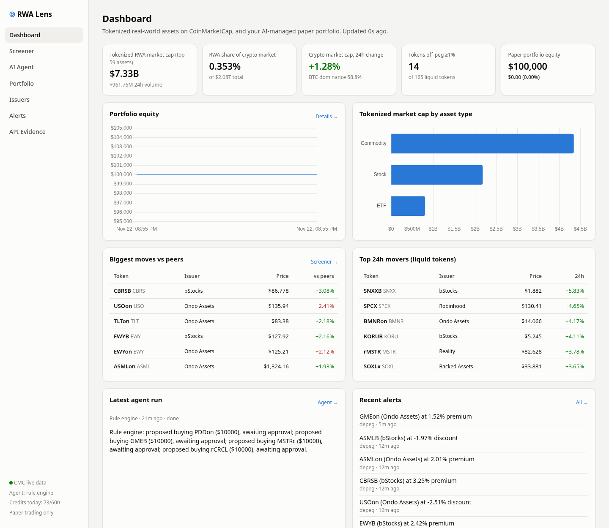
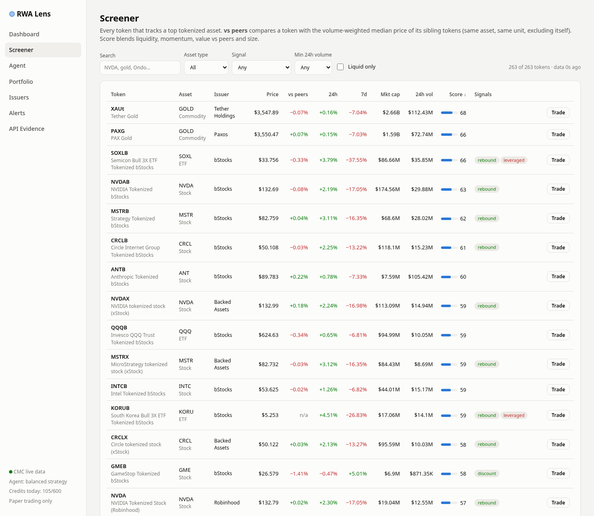
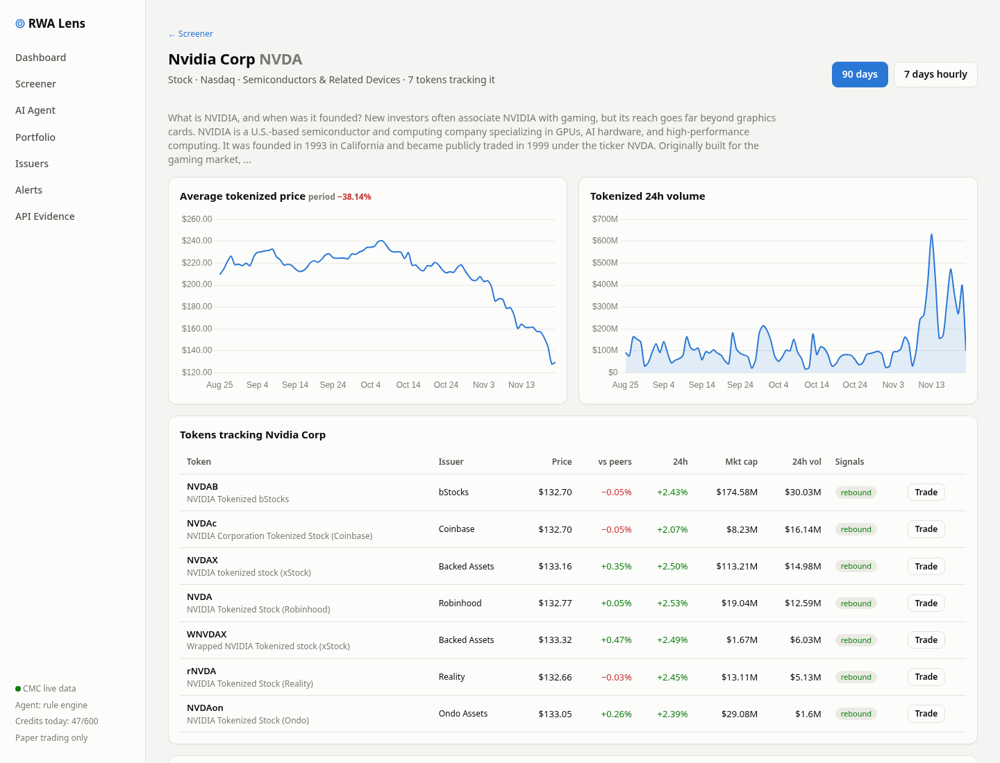
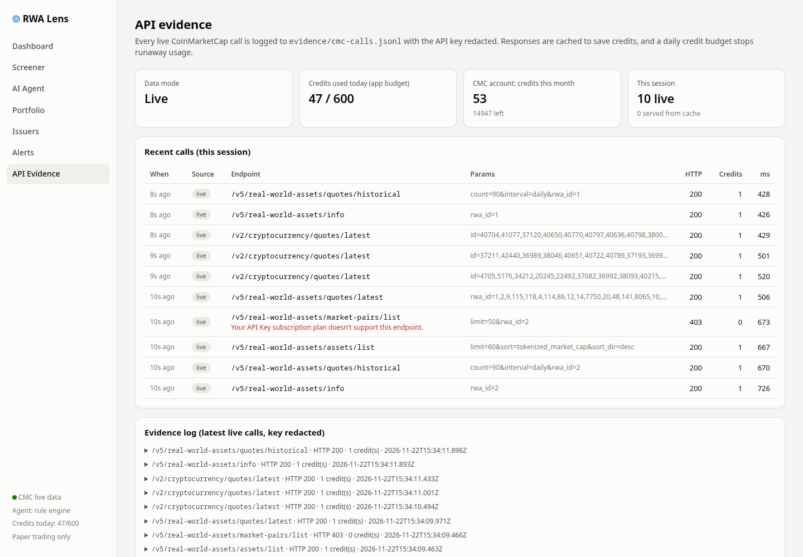
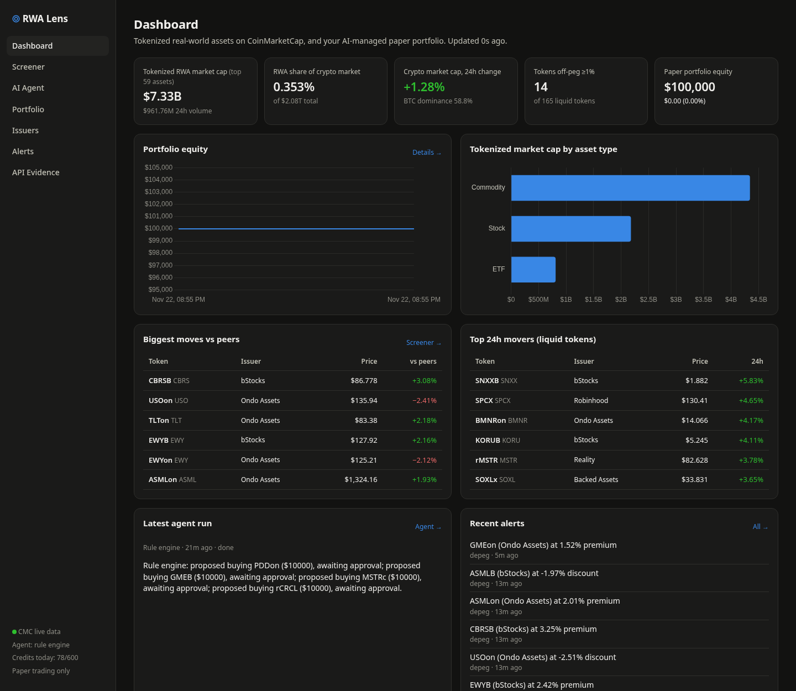

<div align="center">

# ◎ RWA Lens

**Screener, peg monitor and AI paper-trading agent for tokenized real-world assets, built on the CoinMarketCap API.**

Real World Assets track · CMC API Hackathon Round 2 · #BuildwithCMC

   



</div>

## Why

Tokenized stocks, ETFs and gold are now issued by many companies at once. NVIDIA alone has **seven** live tokens (xStocks, Ondo, bStocks, Robinhood, Coinbase, Reality, wrapped xStock), and gold has PAXG, XAUt, Matrixdock and more. They don't trade at the same price, they aren't equally liquid, and some aren't even quoted in the same unit.

RWA Lens uses CoinMarketCap's new `/v5/real-world-assets` endpoints, together with the classic crypto endpoints, to answer three questions:

1. **Which token should I hold?** Every token is priced against its siblings tracking the same asset. That surfaces discounts, premiums and de-pegs, and detects tokens quoted in a different unit instead of calling them 90% de-pegs.
2. **What's moving, and can I actually trade it?** Token-level momentum, liquidity and turnover, and a 0-100 score.
3. **Can an AI manage it?** A Claude agent researches with tools and trades a **paper** portfolio. Risk limits are enforced in code, every step is journaled, and there's an approval queue.

> **Paper trading only.** No real orders are ever sent anywhere. Fills are simulated at live CMC prices with fees and size-based slippage.

## Contents

- [Screenshots](#screenshots)
- [Features](#features)
- [Quick start](#quick-start)
- [CoinMarketCap endpoints used](#coinmarketcap-endpoints-used)
- [The AI agent](#the-ai-agent)
- [MCP server](#mcp-server-claude-desktop--claude-code)
- [Configuration](#configuration)
- [Project structure](#project-structure)
- [Deploying](#deploying)
- [Docs](#docs)

## Screenshots

| Screener | Asset detail |
|---|---|
|  |  |
| **AI agent: journal, approvals, risk settings** | **Issuer scorecard** |
|  |  |
| **API evidence: every live call, key redacted** | **Dark mode** |
|  |  |

## Features

| | |
|---|---|
| **Dashboard** | RWA tokenized market cap, RWA share of total crypto market cap, off-peg count, equity curve, market cap by asset type, biggest moves vs peers, top movers, latest agent run, alerts |
| **Screener** | ~265 tokens across the top ~60 tokenized assets. Search; filter by asset type, signal, volume and liquidity; sort any column; trade from any row |
| **Asset detail** | 90-day or 7-day hourly history of price and volume; every token tracking the asset with *vs peers*; market pairs where the plan allows |
| **AI agent** | Run now or on a schedule; approve or reject proposals; per-run journal (Claude's reasoning summary, tool calls, orders, risk rejections); risk settings, kill switch, strategy notes |
| **Portfolio** | Positions, realized and unrealized P&L, equity curve, order history with slippage and fees, manual trading, reset |
| **Issuers** | Market cap, volume, turnover and **peg tightness** per issuer |
| **Alerts** | De-pegs (liquid token ≥ 1.5% from peers), stop-loss and take-profit exits, agent runs, trades. Optional Telegram |
| **API evidence** | Every live CMC call with the key redacted, credits per call, cache hits, monthly account usage |
| **MCP server** | The same research tools, plus paper orders, for Claude Desktop, Claude Code or any MCP client |

**Signals:** `DISCOUNT` · `PREMIUM` · `MOMENTUM_UP` · `MOMENTUM_DOWN` · `REBOUND` · `ILLIQUID` · `UNIT_MISMATCH` · `LEVERAGED`. The rules are in [docs/ARCHITECTURE.md](docs/ARCHITECTURE.md#signals-and-score).

## Quick start

Requires Node 22+.

```bash
git clone <this repo> && cd rwa-lens
npm install
cp .env.example .env     # add CMC_API_KEY, and optionally ANTHROPIC_API_KEY
npm run build            # build the web UI
npm start                # → http://localhost:8787
```

**No keys? It still runs.**
- No `CMC_API_KEY` means **mock mode**. It replays real responses from `fixtures/recorded/` (create them with `npm run record`), or falls back to a clearly labelled synthetic market in the documented response shapes.
- No `ANTHROPIC_API_KEY` means the agent uses the transparent **rule engine** instead of Claude. Same tools, same risk checks.

| Script | |
|---|---|
| `npm run dev` | API with hot reload on :8787, plus the UI dev server on :5173 (proxies `/api`) |
| `npm run build` / `npm start` | Production build, served by the API server |
| `npm test` | 9 tests: peer pricing, unit mismatch, risk engine, fills, approvals, stop-loss, kill switch, mock shapes. They use a temp data dir and spend no credits |
| `npm run typecheck` | `tsc --noEmit` across server, web, MCP and tests |
| `npm run mcp` | Run the MCP server on stdio |
| `npm run record [n]` | Record real responses for the top *n* assets into `fixtures/recorded/` for mock mode (~65 credits for n = 10) |

## CoinMarketCap endpoints used

| Endpoint | Used for |
|---|---|
| `GET /v5/real-world-assets/assets/list` | RWA universe ranked by tokenized market cap |
| `GET /v5/real-world-assets/quotes/latest` | Per-asset quotes **and every token tracking each asset** (issuer, price, cap, volume) |
| `GET /v5/real-world-assets/quotes/historical` | Charts (90d daily, 7d hourly); 30-day return, volatility and drawdown for the agent |
| `GET /v5/real-world-assets/issuers/list` | Issuer directory: website, total tokens listed |
| `GET /v5/real-world-assets/info` | Asset metadata: description, exchange, industry |
| `GET /v5/real-world-assets/market-pairs/list` | Exchange pairs per asset. **Returns 403 on our key's plan**; handled gracefully, works in mock mode |
| `GET /v2/cryptocurrency/quotes/latest` | Token-level 1h/24h/7d/30d momentum; cheap re-pricing of held positions |
| `GET /v1/global-metrics/quotes/latest` | Total crypto market cap, giving the RWA share of crypto and BTC dominance |
| `GET /v1/key/info` | Credit usage on the evidence page |

### Sample request and response

One real call per endpoint is in [`docs/evidence-sample.jsonl`](docs/evidence-sample.jsonl). The full live log is written to `evidence/cmc-calls.jsonl` (key redacted) and shown on the API Evidence page.

```http
GET https://pro-api.coinmarketcap.com/v5/real-world-assets/quotes/latest?rwa_id=1,2,118,14&skip_invalid=true
X-CMC_PRO_API_KEY: <redacted>
```
```jsonc
{
  "data": { "rwa_assets": [{
    "name": "Gold", "symbol": "GOLD", "rwa_id": 1, "asset_type": "commodity",
    "average_tokenized_price": 3548.11, "tokenized_market_cap": 4344175597.26,
    "tokens": [
      { "symbol": "PAXG", "name": "PAX Gold",     "price": 3551.40, "crypto_id": 4705, "issuer_name": "Paxos" },
      { "symbol": "XAUt", "name": "Tether Gold",  "price": 3548.23, "crypto_id": 5176, "issuer_name": "Tether Holdings" },
      { "symbol": "CGO",  "name": "Comtech Gold", "price": 112.90,  "crypto_id": 20245 }   // per-gram → UNIT_MISMATCH
    ]
  }]},
  "status": { "error_code": "0", "credit_count": 1 }
}
```

### Why "vs peers" instead of CMC's average price

Live data showed CMC's `average_tokenized_price` being skewed by tokens quoted in a different unit: two SanDisk tokens at about $655 against five at about $82 gave an "average" of $87.7, so every real token looked 6% cheap. RWA Lens finds each asset's dominant unit, flags the outliers `UNIT_MISMATCH`, and prices each token against the **volume-weighted median of its other comparable siblings**. Details are in [ARCHITECTURE.md](docs/ARCHITECTURE.md#peer-pricing).

## The AI agent

| | |
|---|---|
| **Claude engine** | Claude Opus 5.5 through the Anthropic SDK **tool runner**: adaptive thinking (summary shown in the journal), server-side refusal fallback, cached system prompt. Tools: `get_portfolio`, `get_market_overview`, `screen_tokens`, `get_token_detail`, `place_order` |
| **Rule engine** | Deterministic fallback. Buys liquid, high-score tokens with DISCOUNT, MOMENTUM_UP or REBOUND (best-priced sibling per asset); exits on momentum breaks or harvestable premiums |
| **Risk, in code** | Every order, from Claude, the rules or you, passes the same checks: kill switch, max position %, gross exposure, cash floor, min volume, max premium paid, allowed types, blocked symbols, leveraged-ETF block, orders per run. Stop-loss and take-profit run on every re-price |
| **Human in the loop** | Autopilot is **off** by default. The agent proposes, you approve, and approved orders are re-validated at the current price |
| **Transparency** | Each run's journal shows reasoning, tool calls and results, orders, rejections, equity before and after, and token usage |

## MCP server (Claude Desktop / Claude Code)

Tools: `rwa_market_overview` · `rwa_screen` · `rwa_token_detail` · `rwa_peg_check` · `rwa_issuer_report` · `portfolio_get` · `paper_order`

**Claude Code**
```bash
claude mcp add rwa-lens -- /ABSOLUTE/PATH/rwa-lens/node_modules/.bin/tsx /ABSOLUTE/PATH/rwa-lens/mcp/server.ts
```

**Claude Desktop** (`claude_desktop_config.json`)
```json
{
  "mcpServers": {
    "rwa-lens": {
      "command": "/ABSOLUTE/PATH/rwa-lens/node_modules/.bin/tsx",
      "args": ["/ABSOLUTE/PATH/rwa-lens/mcp/server.ts"]
    }
  }
}
```

It reads `.env` from the project folder whatever directory it's launched from. Portfolio tools go through the running app (`RWA_LENS_URL`, default `http://localhost:8787`). Try asking:

- *"Which tokenized NVIDIA is cheapest right now, and how liquid is it?"*
- *"Is any gold token de-pegged?"*
- *"Compare Ondo and Backed as issuers."*

## Configuration

All settings go in `.env` (see [`.env.example`](.env.example)). Agent and risk settings are edited in the UI.

| Variable | Default | |
|---|---|---|
| `CMC_API_KEY` | – | Empty means mock mode |
| `ANTHROPIC_API_KEY` | – | Empty means the rule engine |
| `ANTHROPIC_MODEL` | `claude-opus-5-5` | |
| `CMC_DAILY_CREDIT_BUDGET` | `600` | Hard daily cap; serves cached data once reached |
| `ADMIN_TOKEN` | – | **Set on any public deploy.** Required for trading, agent runs and settings |
| `PAPER_STARTING_CASH` | `100000` | |
| `MTM_INTERVAL_MIN` | `10` | Position re-pricing interval |
| `DEPEG_ALERT_PCT` | `1.5` | |
| `TELEGRAM_BOT_TOKEN`, `TELEGRAM_CHAT_ID` | – | Optional alert delivery |
| `DATA_DIR` | `./data` | Portfolio, settings, journal, alerts (JSON) |
| `PORT` | `8787` | |

### Keeping keys safe

- Keys live only in `.env`, which is gitignored. `.env.example` holds empty placeholders.
- The CMC key is only ever sent from the server as a request header. The browser never sees it, and the evidence log writes `<redacted>`.
- **Secret guard** (`scripts/check-secrets.mjs`) blocks any commit that stages a `.env` file, contains the value of a `*_KEY` / `*_TOKEN` / `*_SECRET` from your local `.env`, or contains a key-shaped string (Anthropic, CMC, Telegram, private keys). `npm install` installs it as a pre-commit hook automatically (`core.hooksPath=.githooks`), and CI runs it on every push. Run it by hand with `npm run check:secrets`.
- On public deploys, set `ADMIN_TOKEN` so visitors can't spend your credits.

## Project structure

```
rwa-lens/
├── server/                 Fastify API, data layer, paper engine
│   ├── cmc.ts              CMC client: cache, evidence log, credit budget, mock switch
│   ├── mock.ts             recorded-fixture replay + synthetic market (no key)
│   ├── rwa.ts              endpoint wrappers, live-data clean-up
│   ├── screener.ts         peer pricing, signals, score, issuers, overview
│   ├── portfolio.ts        paper fills, fees, slippage, risk checks, stops
│   ├── settings.ts         agent and risk settings (zod-validated)
│   ├── agent/              claude.ts · rules.ts · tools.ts · journal.ts · run.ts
│   ├── scheduler.ts        scheduled agent runs, mark-to-market
│   ├── alerts.ts           alert feed + Telegram
│   ├── routes.ts           REST API
│   └── index.ts            entry point
├── web/                    Vite + TypeScript + Chart.js single-page app
│   └── src/pages/          dashboard · screener · asset · agent · portfolio · issuers · alerts/evidence
├── mcp/server.ts           MCP server (stdio)
├── scripts/               record-fixtures.ts · check-secrets.mjs (secret guard)
├── .githooks/pre-commit    runs the secret guard on every commit
├── test/core.test.ts       node:test suite
└── docs/                   architecture, API feedback, demo script, screenshots, evidence sample
```

## Deploying

Any Node 22 host works (Render, Fly, Railway):

- **Build:** `npm ci && npm run build`
- **Start:** `npm start`
- **Environment:** `CMC_API_KEY`, `ADMIN_TOKEN`, and optionally `ANTHROPIC_API_KEY`
- **Storage:** attach a persistent disk for `DATA_DIR` so the portfolio survives redeploys

## Docs

- [Architecture](docs/ARCHITECTURE.md): data flow, peer pricing, signals, paper engine, agent, credit discipline, security
- [API feedback](docs/API_FEEDBACK.md): what the CMC API made possible and where it got in the way
- [Demo script](docs/DEMO.md): video walkthrough and submission checklist

## License

[MIT](LICENSE)
